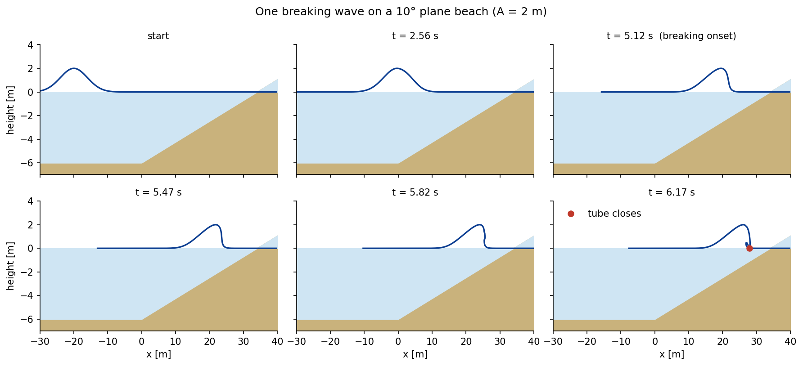
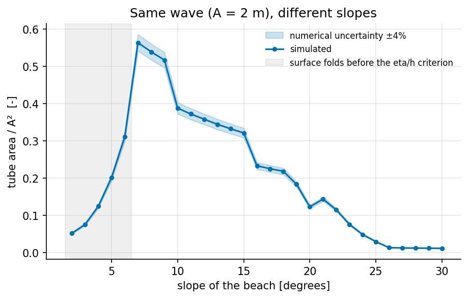
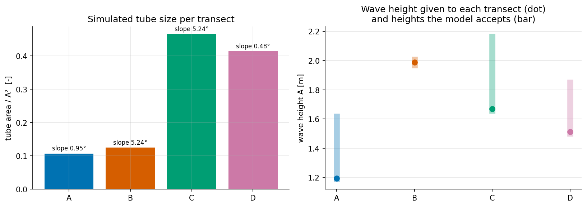
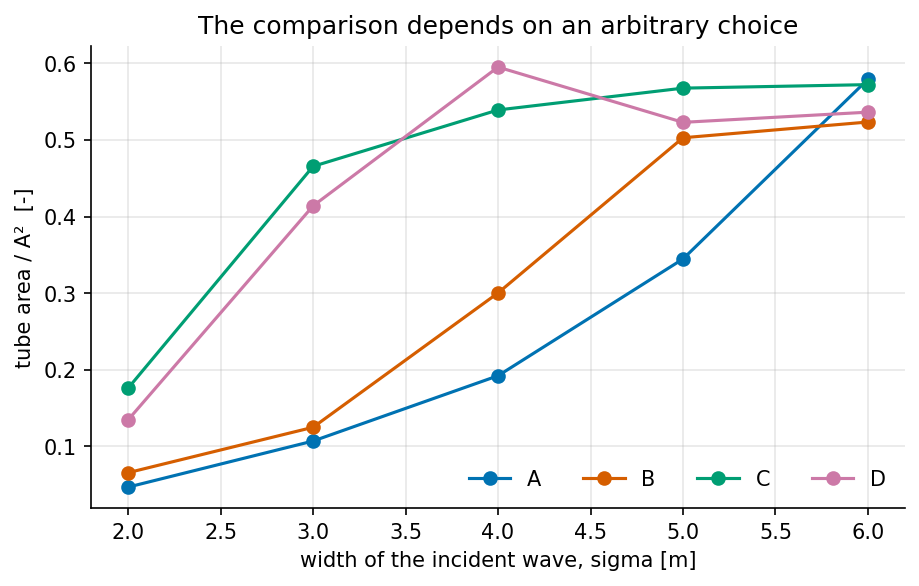
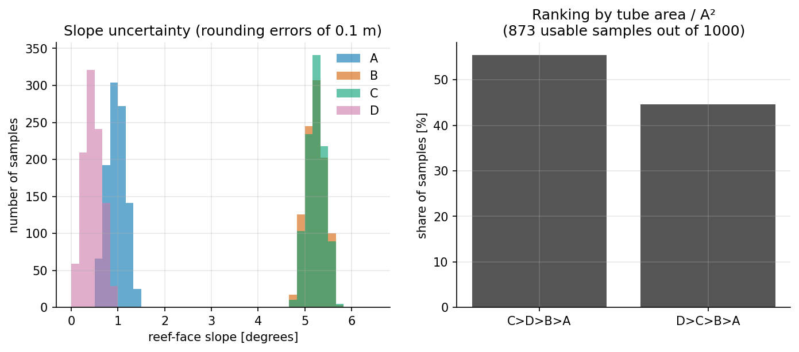
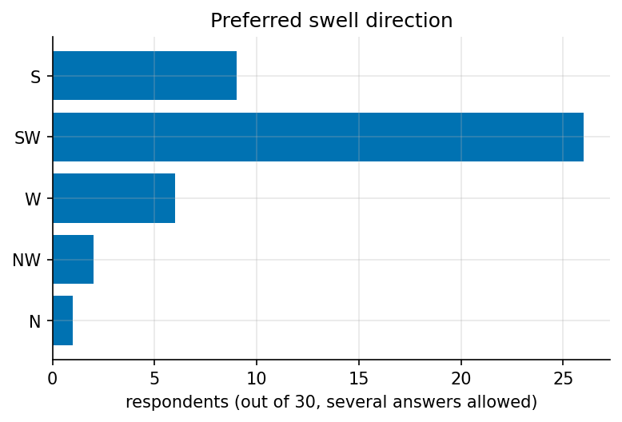

# Wave Breaking over a Reef

**How does the slope of the sea bed change the way a wave breaks? A small physical model, 16 field depth measurements from a surf spot, and an honest look at what they can and cannot tell.**

[](https://github.com/ouzairpatel-maker/wave-breaking-bathymetry/actions/workflows/ci.yml)

[](LICENSE)

## Résumé en français

> **Projet.** Issu d'un TIPE de classes préparatoires réalisé en binôme : comment la pente du fond marin influence-t-elle la forme d'une vague qui déferle (le « tube » des surfeurs) ? Terrain d'étude : un spot récifal de l'Étang-Salé (La Réunion).
>
> **Méthode.** 16 profondeurs mesurées sur 4 transects ; un modèle simple de la surface de l'eau (une ligne de 900 points qui avancent à la vitesse `√(g(h+η))`, puis la lèvre qui tombe comme un projectile) ; des expériences numériques ; un Monte-Carlo (1 000 tirages) sur les erreurs d'arrondi des mesures.
>
> **Résultats (simulés, pas mesurés).** 1) À vague identique, l'effet de la pente est **non monotone** : le tube est maximal vers 7° puis diminue. 2) Le classement initial des 4 transects (C > D > B > A) **n'est pas fiable** : chaque transect recevait une vague de hauteur différente, et le classement dépend de la largeur de la vague choisie. 3) Le modèle n'est comparé à aucune vague réelle.
>
> **Outils.** Python, NumPy, pandas, Matplotlib, pytest (26 tests), GitHub Actions. Les limites sont détaillées dans [`docs/limitations.md`](docs/limitations.md).
>
> **Méthode de travail.** Le modèle, les données et les premiers scripts viennent du TIPE. Ce dépôt (simplification du code, tests, documentation) a été réalisé avec l'aide d'un assistant de programmation basé sur un LLM ; les choix, les résultats et les limites présentés ici sont de ma responsabilité.

---

| | |
|---|---|
| **Question** | Surfers look for *plunging* waves: the top of the wave (the lip) is thrown forward and closes a tube. Local lore says *"the steeper the reef, the hollower the wave"*. Can a simple model say something about it? |
| **Method** | Field survey (4 transects × 4 depths) → surface-marker model of a breaking wave, checked against formulas → numerical experiments → Monte Carlo on the measurement errors. |
| **Result** | In the model, with the wave kept identical, slope has a strong effect that is **not monotonic** (best near 7°). The first ranking of the four surveyed transects is **not robust**. No result is compared with a real breaking wave. |



*One simulated wave on a 10° plane beach: the crest outruns the base, the front steepens, the lip is thrown forward and lands, closing the tube. Everything on this page is simulated unless it says "measured".*

## The model in one paragraph

The water surface is a line of 900 points. At each time step every point moves toward the shore at `c = √(g (h + η))` (`h` depth, `η` height above still water), so high points go faster and the front steepens. When `η/h` reaches 0.78 the wave is allowed to break: a point that catches up with its neighbour is thrown forward like a projectile, and the first one to touch the water closes the tube. The size of the tube is the area of air under the lip's flight, divided by the wave height squared. Details and formulas: [`docs/model.md`](docs/model.md).

## Results

All numbers are produced by `python run_all.py` (seed 12345) and saved in [`results/`](results/).

### 1. One wave, many slopes (the fair test)



Same wave (A = 2 m, σ = 4 m, 6 m of water offshore), plane beach, slope from 2° to 30°.

* The tube size **rises up to 7°** (0.56) and **then falls**, to about 0.01 at 26–30°: *steeper helps up to an optimum, then hurts*.
* Between 2° and 6° (grey) the surface folds over *before* the depth criterion is met: the two breaking criteria of the model disagree and these values are not reliable (`jet_reach` is even negative at 2–3°).
* Numerical uncertainty is about ±4 % (one case, three grid sizes, `results/tables/resolution_check.csv`): small differences between neighbouring slopes mean nothing.
* The position of the optimum depends on the wave chosen: it is not a property of the sea bed alone.

### 2. The four surveyed transects (the original study)



| Transect | Swell | Reef-face slope | Wave height given (A) | Tube area / A² |
|---|---|---|---|---|
| A | S | 0.95° | 1.19 m | 0.107 |
| B | SW | 5.24° | 1.99 m | 0.125 |
| C | W | 5.24° | 1.67 m | 0.466 |
| D | NW | 0.48° | 1.51 m | 0.414 |

Ranking: C > D > B > A. **Why it should not be trusted:**

1. **The waves are not the same.** The original study gave each transect the wave `A = 1.02 · 0.78 · h_reef`, so deeper reefs got bigger waves (1.19 m to 1.99 m). The comparison mixes slope and wave size. The model accepts only a narrow range of heights on each transect (right panel), and **no height is accepted on all four**, so a "same wave everywhere" test is impossible.
2. **Same slope, very different tubes.** B and C have the identical slope (5.24°) but tubes of 0.125 and 0.466: slope is not what separates them in this model.
3. **The two breaking criteria disagree on all four transects** (the surface folds over before `η/h ≥ 0.78`), the regime in which the metric is least reliable.

### 3. Sensitivity to the width of the incident wave



The incident wave is a Gaussian bump; its width σ is a choice (the real swell is a long periodic wave). The ranking by tube area changes with σ:

| σ | 2 m | 3 m (reference) | 4 m | 5 m | 6 m |
|---|---|---|---|---|---|
| Ranking | C > D > B > A | C > D > B > A | D > C > B > A | C > D > B > A | A > C > D > B |

The ranking is not even monotonic in σ: C and D swap at 4 m and swap back at 5 m (0.57 vs 0.52), and at σ = 6 m the four values are within 0.52–0.58, so that ranking means little.

### 4. Measurement uncertainty (Monte Carlo)



1 000 random surveys: each depth and each tide correction is shifted by a uniform error of ±0.05 m (all readings are rounded to 0.1 m). This is an assumption about the errors, not a measured uncertainty.

* **Slopes (95 % intervals):** A 0.59–1.33°, B 4.86–5.61°, C 4.87–5.60°, D 0.11–0.84°. The data separate "gentle" (A, D) from "steeper" (B, C) but cannot order B and C, or A and D.
* **127 of 1 000 samples are discarded**: on transect B the wave range accepted by the model is only 0.08 m wide, and in 12.7 % of the samples the calibrated wave already breaks offshore. 873 samples remain.
* **Ranking in the remaining samples:** C > D > B > A in 55.4 %, D > C > B > A in 44.6 %. So the model separates {C, D} from {A, B} reliably, but **cannot decide between C and D**. This is a statement about the model on the original calibration, not about the real reefs.

### 5. Survey of 30 surfers (measured)



26 of 30 list the south-west swell among their preferred ones (several answers allowed). This is a preference about swell *direction* (it mixes wave shape, frequency, size, crowd and skill). It is **not** compared with the model: ranking four items cannot be statistically significant.

### What can and cannot be concluded

| Supported (within the model) | Not supported |
|---|---|
| The code solves its equations correctly (tests below). | That the model is realistic: it was never compared with a measured wave. |
| With identical waves, slope has a non-monotonic effect on the simulated tube. | That any of the four reefs makes "better" waves: the ranking depends on the wave height imposed, on the wave width and on the metric. |
| The field data separate gentle (A, D) from steeper (B, C) faces. | Anything quantitative about a real surf spot. |

## Run it

```bash
git clone https://github.com/ouzairpatel-maker/wave-breaking-bathymetry.git
cd wave-breaking-bathymetry
pip install -r requirements.txt
python -m pytest            # 26 tests, a few seconds
python run_all.py --quick   # whole analysis with fewer simulations, a few seconds
python run_all.py           # full run, about 2 minutes, writes results/
```

Minimal use of the model:

```python
from wavebreak import BEACH, plane_beach, simulate

result = simulate(plane_beach(offshore_depth=6.0, slope_deg=10.0), amplitude=2.0, params=BEACH)
print(result.broke, result.tube_area_normalized)   # True 0.388...
```

## Repository

```
wavebreak/model.py      the physical model (surface markers, breaking, tube)
wavebreak/data.py       reading and checking the field data
wavebreak/analysis.py   the experiments (transects, slope sweep, width, Monte Carlo)
wavebreak/plots.py      figures
run_all.py              runs everything, writes tables, figures and key_numbers.json
data/                   16 depth measurements, transect info, survey of 30 surfers
tests/                  26 tests
docs/model.md           how the model works, step by step
docs/limitations.md     what is wrong or missing, most important first
results/                tables (csv), figures (png), key_numbers.json
```

## How the model is checked

| Test | Result |
|---|---|
| Speed of a tiny wave on a flat bed vs `√(g h)` | within 1 % |
| Time at which the front overturns on a flat bed vs a formula (method of characteristics) | 0.04 % difference |
| Distance flown by the closing lip vs `u·√(2H/g)` | 0.4 % difference |
| Data checks (`corrected = measured − tide`, positive depths) | all 16 points consistent |
| Results table of the original TIPE script (onset position and jet reach, 4 transects) | identical to the 2 decimals published |

These tests show that the code solves **its own equations** correctly. They say nothing about whether the equations describe real waves.

## Main limitations

1. No comparison with a real breaking wave.
2. The width of the incident wave is a choice and it changes the ranking.
3. Two breaking criteria that disagree on gentle slopes.
4. Empirical jet speed (`b = 0.4`), fixed breaker index (0.78), no shoaling, 2D only.
5. Only 4 points per transect, depths rounded to 0.1 m.

Full list in [`docs/limitations.md`](docs/limitations.md).

## About

Developed from a two-person *TIPE* project (French classes préparatoires): the field survey, the questionnaire, the model and the first scripts come from it. This repository, the simplified code, the tests and the documentation were produced with the help of an LLM-based coding assistant. The choices, the results and the limitations presented here are the responsibility of the repository's author, [**ouzairpatel-maker**](https://github.com/ouzairpatel-maker).

Tools: Python, NumPy, pandas, Matplotlib, pytest, GitHub Actions. MIT licence.
